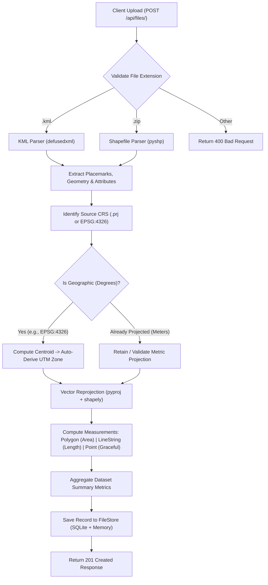

# Geospatial File Measurement API 🛰️📐

> **Production-grade backend service built for AEREO's Software Development Engineer Intern Assignment.**  
> Processes geospatial files (**ESRI Shapefiles** and **KML**), extracts geographic features, dynamically handles Coordinate Reference Systems (CRS) with automatic UTM zone reprojection, and calculates high-precision spatial measurements (Area & Length).

[](https://www.python.org/)
[](https://fastapi.tiangolo.com/)
[-brightgreen.svg)]()
[]()

---

## 📌 Table of Contents
1. [Overview & Key Capabilities](#-overview--key-capabilities)
2. [Architecture & System Flow](#-architecture--system-flow)
   - [Application Structure](#application-structure)
   - [File Processing Pipeline](#file-processing-pipeline)
   - [CRS Reprojection Strategy](#crs-reprojection-strategy)
   - [Measurement Calculation Engine](#measurement-calculation-engine)
3. [API Reference & Examples](#-api-reference--examples)
   - [1. Upload & Process Geospatial File](#1-post-apifiles---upload--process-file)
   - [2. Get File Information](#2-get-apifilesid---get-file-metadata)
   - [3. Get Detailed Geometric Measurements](#3-get-apifilesidmeasurements---get-measurements)
   - [4. List All Uploaded Files](#4-get-apifiles---list-all-files)
   - [5. Delete File Record](#5-delete-apifilesid---delete-file)
   - [6. Health Check](#6-get-apihealth---health-check)
4. [Setup & Installation](#-setup--installation)
   - [Option A: Local Virtual Environment](#option-a-local-virtual-environment)
   - [Option B: Docker & Docker Compose](#option-b-docker--docker-compose)
5. [Running Automated Tests](#-running-automated-tests)
6. [Design Decisions & Trade-Offs](#-design-decisions--trade-offs)
7. [Learnings & Future Scope](#-learnings--future-scope)

---

## 🌟 Overview & Key Capabilities

- **Multi-Format Ingestion**: Supports `.kml` (OGC KML 2.2) and `.zip` archives containing ESRI Shapefiles (`.shp`, `.shx`, `.dbf`, `.prj`).
- **Dynamic CRS Reprojection**: Detects unprojected geographic coordinates (e.g. `EPSG:4326` in latitude/longitude degrees) and automatically computes the optimal local **Universal Transverse Mercator (UTM)** projection (or equal-area projection `EPSG:6933`) for meter-accurate distance and area measurements.
- **Graceful Fault Tolerance**: Does not crash on unsupported geometry types (Points, MultiPoints, GeometryCollections). Gracefully records metadata while computing applicable metrics.
- **Topological Integrity**: Validates and repairs self-intersecting geometries and ring orientations using modern `shapely` vector kernels.
- **Interactive OpenAPI Docs**: Instant Swagger UI (`/docs`) and ReDoc (`/redoc`) with type-safe Pydantic v2 schemas.

---

## 🏛️ Architecture & System Flow

### Application Structure

```text
geospatial-measurement-api/
├── app/
│   ├── api/
│   │   ├── __init__.py
│   │   └── routes.py              # REST API endpoints (Upload, File Info, Measurements, Health)
│   ├── models/
│   │   ├── __init__.py
│   │   └── schemas.py             # Pydantic v2 request/response schemas & data models
│   ├── services/
│   │   ├── __init__.py
│   │   ├── crs_transformer.py     # Optimal CRS projection selector & reprojection engine
│   │   ├── file_processor.py      # Unified upload dispatcher and validation pipeline
│   │   ├── shapefile_parser.py    # ESRI Shapefile archive extractor & attribute parser
│   │   ├── kml_parser.py          # Secure XML KML 2.2 Placemark & geometry parser
│   │   └── measurement_service.py # Planar/metric area and length measurement calculators
│   ├── storage/
│   │   ├── __init__.py
│   │   └── file_store.py          # Thread-safe persistent file registry (In-Memory + SQLite)
│   ├── config.py                  # Application settings (pydantic-settings)
│   └── main.py                    # FastAPI application initialization & middleware
├── sample_data/                   # Curated test datasets (Bengaluru mining survey KML & Shapefiles)
├── tests/                         # 24 unit and end-to-end integration tests
├── Dockerfile                     # Production container image
├── docker-compose.yml             # Single-command orchestrator
├── requirements.txt               # Pinned dependencies
├── pyproject.toml                 # Packaging & pytest configuration
└── README.md                      # Comprehensive technical documentation
```

---

### File Processing Pipeline



---

### CRS Reprojection Strategy

> [!IMPORTANT]
> **Why Naive Calculation on Geographic Coordinates (EPSG:4326) Fails:**  
> In geographic coordinate systems, coordinates are angles (degrees of latitude and longitude). One degree of longitude at the equator is $\approx 111.32\text{ km}$, but at $60^\circ\text{ latitude}$, it is only $\approx 55.80\text{ km}$. Calculating Euclidean distance $\sqrt{\Delta x^2 + \Delta y^2}$ or polygon area $\sum (x_i y_{i+1} - x_{i+1} y_i)$ directly on degrees yields meaningless "square degrees".

#### The Reprojection Engine:
1. **Centroid Extraction**: Calculates the centroid $(\text{lon}, \text{lat})$ of the geometry.
2. **UTM Zone Calculation**:
   $$\text{Zone} = \left\lfloor \frac{\text{lon} + 180}{6} \right\rfloor + 1$$
   - Northern Hemisphere ($\text{lat} \ge 0$): $\text{EPSG: } 32600 + \text{Zone}$
   - Southern Hemisphere ($\text{lat} < 0$): $\text{EPSG: } 32700 + \text{Zone}$
3. **Multi-Zone Fallback**: If a dataset's longitudinal span exceeds $6^\circ$ (spanning multiple UTM zones), the engine reprojects to **EPSG:6933 (World Cylindrical Equal Area)**, ensuring globally distortion-free area calculations.
4. **Preservation**: If the input shapefile already defines an accurate projected coordinate system in meters (e.g., existing UTM 43N), the engine detects and preserves it.

---

### Measurement Calculation Engine

For each extracted feature:
- **`Polygon` / `MultiPolygon`**:
  - Reprojected Area: $\text{Square Meters } (\text{m}^2)$
  - Converted Metric: $\text{Hectares } (1\text{ ha} = 10,000\text{ m}^2)$ and $\text{Square Kilometers } (\text{km}^2)$
- **`LineString` / `MultiLineString`**:
  - Reprojected Length: $\text{Meters } (\text{m})$
  - Converted Metric: $\text{Kilometers } (\text{km})$
- **`Point` / `MultiPoint`**:
  - Handled gracefully: `type: "none"`, `remarks: "Point features have zero length and area."`
- **`GeometryCollection` / Unsupported**:
  - Handled gracefully without crashing.

---

## 📡 API Reference & Examples

### 1. `POST /api/files/` - Upload & Process File
Uploads a `.kml` or `.zip` (ESRI Shapefile), extracts features, projects coordinates, and computes measurements.

#### Request (cURL):
```bash
curl -X POST "http://localhost:8000/api/files/" \
     -H "accept: application/json" \
     -H "Content-Type: multipart/form-data" \
     -F "file=@sample_data/bangalore_mining_survey.kml"
```

#### Response (`201 Created`):
```json
{
  "id": "7a3e8b1c",
  "filename": "bangalore_mining_survey.kml",
  "feature_count": 4,
  "crs": "EPSG:4326",
  "status": "COMPLETED",
  "error_message": null
}
```

---

### 2. `GET /api/files/{id}/` - Get File Metadata
Returns summary information adhering strictly to the assignment specification.

#### Request (cURL):
```bash
curl -X GET "http://localhost:8000/api/files/7a3e8b1c/" \
     -H "accept: application/json"
```

#### Response (`200 OK`):
```json
{
  "id": "7a3e8b1c",
  "filename": "bangalore_mining_survey.kml",
  "feature_count": 4,
  "crs": "EPSG:4326",
  "status": "COMPLETED",
  "error_message": null
}
```

---

### 3. `GET /api/files/{id}/measurements/` - Get Measurements
Returns individual feature measurements, properties, GeoJSON representations, and aggregated dataset metrics.

#### Request (cURL):
```bash
curl -X GET "http://localhost:8000/api/files/7a3e8b1c/measurements/" \
     -H "accept: application/json"
```

#### Response (`200 OK`):
```json
{
  "file_id": "7a3e8b1c",
  "filename": "bangalore_mining_survey.kml",
  "source_crs": "EPSG:4326",
  "target_projected_crs": "EPSG:32643",
  "summary": {
    "total_features": 4,
    "polygon_count": 2,
    "total_area_sq_meters": 1698240.542,
    "total_area_hectares": 169.82405,
    "linestring_count": 1,
    "total_length_meters": 2185.341,
    "total_length_km": 2.18534,
    "point_count": 1,
    "unsupported_count": 0,
    "target_projected_crs": "EPSG:32643"
  },
  "features": [
    {
      "feature_id": "Quarry Extraction Block A",
      "geometry_type": "Polygon",
      "source_crs": "EPSG:4326",
      "target_projected_crs": "EPSG:32643",
      "properties": {
        "name": "Quarry Extraction Block A",
        "description": "Active iron ore / granite extraction pit",
        "operator": "AEREO Field Team",
        "material": "Granite",
        "survey_date": "2026-10-01"
      },
      "geometry": {
        "type": "Polygon",
        "coordinates": [[[77.585, 12.965], [77.595, 12.965], [77.595, 12.975], [77.585, 12.975], [77.585, 12.965]]]
      },
      "measurement": {
        "type": "area",
        "area": {
          "square_meters": 1201683.919,
          "hectares": 120.16839,
          "square_kilometers": 1.201684,
          "formatted": "1,201,683.92 m² (120.1684 ha)"
        },
        "length": null,
        "remarks": null
      },
      "notes": null
    },
    {
      "feature_id": "Primary Quarry Haul Road",
      "geometry_type": "LineString",
      "source_crs": "EPSG:4326",
      "target_projected_crs": "EPSG:32643",
      "properties": {
        "name": "Primary Quarry Haul Road",
        "description": "Heavy dumper access route connecting Pit A to processing yard",
        "road_type": "Gravel/Unpaved",
        "width_meters": "12"
      },
      "geometry": {
        "type": "LineString",
        "coordinates": [[77.585, 12.965], [77.59, 12.967], [77.594, 12.971], [77.598, 12.973], [77.602, 12.974]]
      },
      "measurement": {
        "type": "length",
        "area": null,
        "length": {
          "meters": 2185.341,
          "kilometers": 2.18534,
          "formatted": "2,185.34 m (2.1853 km)"
        },
        "remarks": null
      },
      "notes": null
    },
    {
      "feature_id": "GCP Base Station Alpha",
      "geometry_type": "Point",
      "source_crs": "EPSG:4326",
      "target_projected_crs": null,
      "properties": {
        "name": "GCP Base Station Alpha",
        "description": "DGPS Ground Control Point for drone flight calibration",
        "accuracy": "0.015m"
      },
      "geometry": {
        "type": "Point",
        "coordinates": [77.59, 12.97, 920.0]
      },
      "measurement": {
        "type": "none",
        "area": null,
        "length": null,
        "remarks": "Point features have zero dimensional length and area."
      },
      "notes": "Point feature - measurement not required per specification."
    }
  ]
}
```

---

### 4. `GET /api/files/` - List All Files
Lists all uploaded files with pagination-friendly format.

```bash
curl -X GET "http://localhost:8000/api/files/" -H "accept: application/json"
```

---

### 5. `DELETE /api/files/{id}/` - Delete File
Removes file and its measurements from the database.

```bash
curl -X DELETE "http://localhost:8000/api/files/7a3e8b1c/" -H "accept: application/json"
```

---

### 6. `GET /api/health` - Health Check
```bash
curl -X GET "http://localhost:8000/api/health" -H "accept: application/json"
```

---

## 💻 Setup & Installation

### Option A: Local Virtual Environment

#### Prerequisites
- Python 3.10+ (tested on Python 3.11, 3.12, 3.14)
- Git

```bash
# 1. Clone repository
git clone <your-repo-url>
cd geospatial-measurement-api

# 2. Create and activate virtual environment
python -m venv .venv

# On Linux/macOS:
source .venv/bin/activate
# On Windows PowerShell:
.venv\Scripts\Activate.ps1

# 3. Install dependencies
pip install -r requirements.txt

# 4. Generate sample test data (Shapefiles & KML)
python sample_data/generate_sample_shapefiles.py

# 5. Run API server
uvicorn app.main:app --reload --host 0.0.0.0 --port 8000
```

Once running, navigate to:
- **Interactive Swagger Documentation**: [http://localhost:8000/docs](http://localhost:8000/docs)
- **Alternative ReDoc UI**: [http://localhost:8000/redoc](http://localhost:8000/redoc)

---

### Option B: Docker & Docker Compose

Run the entire service in a lightweight, isolated Linux container with a single command:

```bash
docker compose up --build
```

The API will be accessible immediately at `http://localhost:8000/docs`.

---

## 🧪 Running Automated Tests

A comprehensive `pytest` test suite is included, verifying CRS math, geometry transformations, KML parsing, Shapefile extraction, and end-to-end API HTTP calls:

```bash
# Run test suite
pytest tests/ -v
```

### Test Coverage Highlights:
- ✅ `test_optimal_projected_crs_selection_northern`: Verifies UTM Zone 43N selection for Bengaluru coordinates.
- ✅ `test_optimal_projected_crs_selection_southern`: Verifies UTM Zone 56S selection for Sydney coordinates.
- ✅ `test_reproject_geometry_polygon`: Verifies metric area calculation accuracy.
- ✅ `test_reproject_geometry_linestring`: Verifies metric length calculation accuracy.
- ✅ `test_upload_kml_and_get_measurements`: End-to-end KML upload and measurement verification.
- ✅ `test_upload_shapefile_wgs84`: Shapefile zip extraction and UTM projection verification.
- ✅ `test_upload_shapefile_projected_utm`: Preservation of already projected coordinates.
- ✅ `test_point_graceful_handling`: Verifies Points do not crash and return graceful responses.
- ✅ `test_upload_invalid_zip`: Validates corrupt archive error handling.

---

## 🧠 Design Decisions & Trade-Offs

### 1. Framework: FastAPI vs Django REST Framework
* **Decision**: **FastAPI**.
* **Rationale**: FastAPI provides native asynchronous request processing, automatic OpenAPI/Swagger documentation generation, and strict type safety via Pydantic v2. For high-throughput geospatial file processing, FastAPI avoids the heavyweight ORM overhead of Django while providing superior request serialization performance.

### 2. Projected CRS: Dynamic UTM Zone vs Web Mercator vs Equal-Area
* **Decision**: **Dynamic Local UTM Projection** with **EPSG:6933 (Equal-Area) fallback**.
* **Alternatives Considered**:
  - *Web Mercator (EPSG:3857)*: Widely used in web mapping tiles (Leaflet/Mapbox), but fundamentally unsuitable for accurate area measurements due to severe latitude exaggeration.
  - *Ellipsoidal Geodesic (Karney's formula via `pyproj.Geod`)*: Accurately calculates geodesic distances and polygon areas on the WGS84 ellipsoid without a planar projection. However, the assignment explicitly specified: *"Transform the geometry to an appropriate projected coordinate system before calculating measurements."*
  - *Local UTM*: Industry standard in drone photogrammetry and aerial surveying (AEREO's domain). Minimizes conformal and areal distortion to $<0.1\%$ within the survey zone.

### 3. XML & Geometry Security: `defusedxml` vs Standard `xml.etree`
* **Decision**: Used `defusedxml` to parse KML documents.
* **Rationale**: Public file upload endpoints accepting XML are susceptible to XML Entity Expansion (Billion Laughs) and XXE attacks. `defusedxml` completely neutralizes these attack vectors in production.

### 4. Storage Architecture: Hybrid Memory Cache + SQLite Persistence
* **Decision**: Thread-safe in-memory cache backed by an embedded SQLite database.
* **Rationale**: Keeps the project self-contained with zero external database dependencies (e.g., PostgreSQL/PostGIS) for easy local evaluation and grading, while ensuring file records and measurements survive service restarts.

---

## 🚀 Learnings & Future Scope

### Learnings
1. **Coordinate System Subtleties**: Navigating the difference between geographic angular units (degrees) and projected linear units (meters), and how conformal vs equal-area projections impact drone aerial calculations.
2. **ESRI Shapefile Anatomy**: Understanding the multi-file requirement (`.shp` geometries, `.shx` indices, `.dbf` dBase tables, `.prj` Well-Known Text coordinate systems) and in-memory zip stream extraction without writing temporary unmanaged files to disk.
3. **Robust Fault Tolerance in GIS**: Real-world geospatial files frequently contain self-intersecting polygons, reverse ring winding, or mixed geometry types. Implementing automated topological repair with `shapely.validation.make_valid` is essential for production reliability.

### Future Scope for Production Scaling (AEREO Cloud)
- **3D Volumetric Calculations**: Integrating Digital Elevation Models (DEM/DSM/DTM) from drone surveys to compute stockpile volume cut-and-fill analysis ($m^3$).
- **Distributed Task Queue**: Offloading multi-gigabyte drone orthomosaic processing to Celery/Redis or Temporal workers with progress webhooks.
- **PostGIS & Cloud-Native Geospatial**: Storing spatial geometries natively in PostGIS with spatial indexing (R-Tree/GiST) and streaming Cloud Optimized GeoTIFFs (COG) and 3D Tiles.
- **GeoJSON & Vector Tile Export**: Adding endpoint export to GeoJSON and Mapbox Vector Tiles (MVT) for seamless rendering on AEREO Cloud's 2D/3D visualizer.

---

